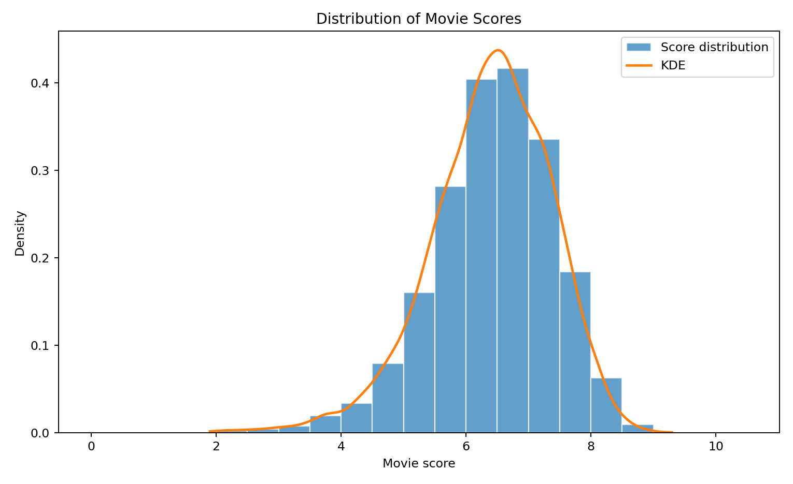
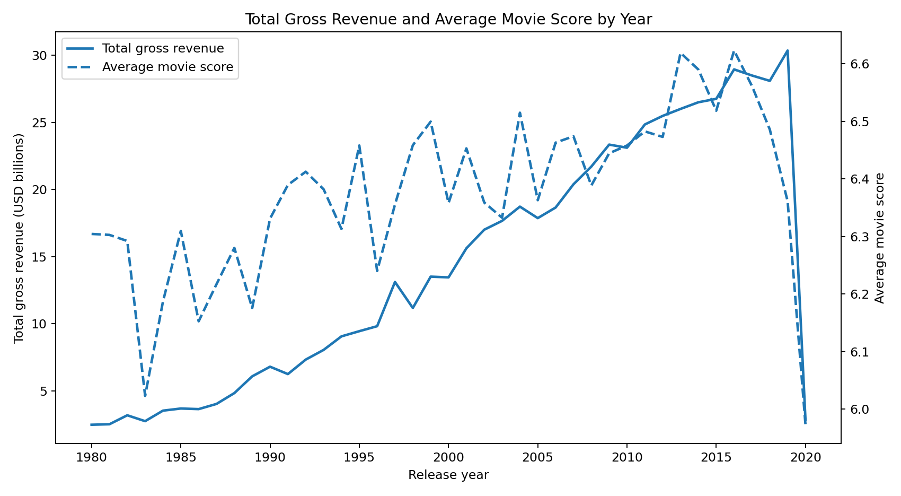
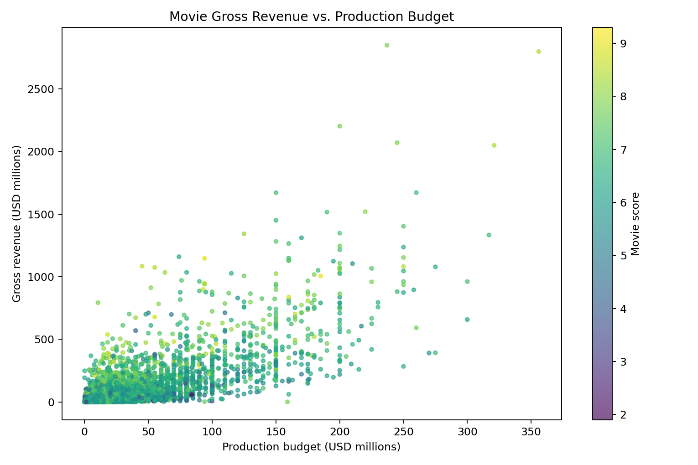

# Movie Database Design & SQL Analysis

**SQL | SQLite | Python | Pandas | Data Visualization**

## Project Overview

This project explores relational database design and SQL-based analysis using movie industry data.

Originally developed as a collaborative final project for CDS 302 at George Mason University in Fall 2024, the project focuses on organizing movie data into relational tables, querying information using SQL, and visualizing patterns in movie ratings, budgets, and box office revenue.

The original project was later reconstructed for this portfolio to improve reproducibility and provide executable Python and SQL files.

## Project Objectives

- Design a relational database to organize movie industry data.
- Reduce redundancy through database normalization.
- Analyze movie performance using SQL queries.
- Explore relationships among movie ratings, production budgets, and gross revenue.
- Communicate findings through Python visualizations.

## Technologies Used

- **SQL / SQLite:** Relational database design and analytical queries
- **Python:** Database construction and data analysis
- **Pandas:** Data processing
- **Matplotlib:** Data visualization

## Database Design

The reconstructed database contains 7,668 movie records and the following relational tables:

| Table | Description |
|---|---|
| Movies | Movie information and performance metrics |
| Directors | Director information |
| Actors | Actor information |
| Companies | Production company information |
| Genres | Movie genre information |
| Movie_Actors | Relationships between movies and actors |
| Movie_Genres | Relationships between movies and genres |

The reconstructed database includes primary and foreign key relationships to support relational queries and maintain referential integrity.

## SQL Analysis

The project demonstrates SQL techniques including:

- **JOIN:** Combining related tables
- **GROUP BY / ORDER BY:** Aggregating and ranking movie performance
- **HAVING:** Filtering aggregated results
- **Aggregate Functions:** COUNT, AVG, SUM
- **Common Table Expressions (CTEs):** Structuring analytical queries
- **Window Functions:** Ranking movies using RANK() and PARTITION BY
- **String Operations:** Searching movie titles using LIKE

See [SQL Analysis Queries](analysis_queries.sql).

## Python Data Visualization

### 1. Distribution of Movie Scores



Movie ratings are concentrated around the 6–7 score range, with relatively fewer movies at the extremes.

### 2. Total Gross Revenue and Average Movie Score by Year



This visualization compares annual box office revenue totals and average movie scores over time.

The final year's results should be interpreted cautiously because data coverage may be incomplete.

### 3. Production Budget vs. Gross Revenue



The scatter plot illustrates a positive association between production budgets and gross revenue, while showing substantial variation across individual movies.

Movie scores are represented using a color scale.

## Reproducing the Analysis

The project includes scripts to rebuild the database and recreate the visualizations.

**1. Install dependencies**

```bash
pip install pandas numpy matplotlib scipy
```

**2. Build the SQLite database**

```bash
python build_database.py
```

**3. Generate the visualizations**

```bash
python visualize_movies.py
```

The visualization script saves the resulting charts in the `figures/` directory.

Analytical SQL queries are available in `analysis_queries.sql`.

## Original Academic Project

**Course:** CDS 302 — George Mason University  
**Semester:** Fall 2024  
**Project Type:** Collaborative team project  
**Team Members:** Jimin Lee, Soobin Jang, Yoonjoo Lee

My contributions included participating in relational database design, normalization, and SQL query development.

The original academic project included database modeling, SQL analysis, and Python-based visualizations.

### Project Documentation

- [Final Project Report](CDS_302___Final_Project_Report.pdf)
- [Final Presentation](CDS%20302.pptx.pdf)

## Portfolio Reconstruction

The executable Python scripts, SQL queries, and `movies_portfolio.db` were reconstructed in 2026 using the original project materials and source data.

The reconstruction improves the consistency between the database schema and analytical queries. It should be distinguished from the original team's submitted implementation.

## Dataset

**Source:** [Movie Industry Dataset — Kaggle](https://www.kaggle.com/datasets/danielgrijalvas/movies)

The dataset contains movie titles, ratings, genres, release years, budgets, gross revenue, and other movie-related attributes.

## Key Takeaways

This project strengthened my understanding of relational database modeling, SQL-based data analysis, and Python visualization.

It demonstrates how structured data management and analytical queries can transform raw industry data into interpretable insights.
